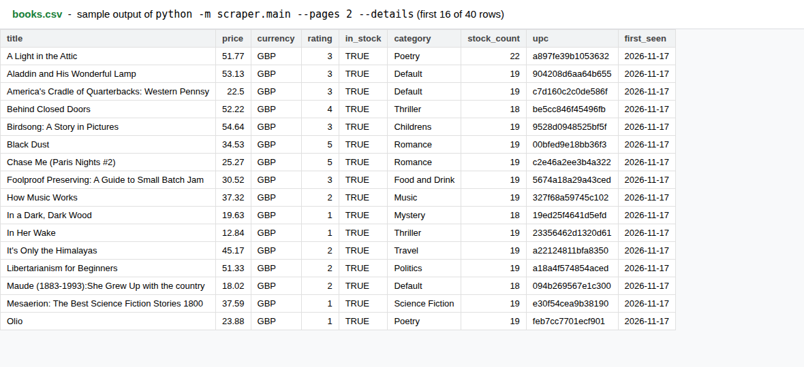

# Website Scraper → Clean Google Sheet, Daily

**A polite, scheduled scraper that turns a product catalogue into a clean, de-duplicated spreadsheet - prices as numbers, ratings as integers, stock as true/false - and keeps it up to date every day.**



*Image: the first 16 rows of `output/sample-books.csv`, produced by a real run against [books.toscrape.com](https://books.toscrape.com), a public sandbox site built for scraping practice.*

## Features

- **Polite by default** - descriptive User-Agent, checks `robots.txt`, waits 1.5 s between requests (configurable), retries with backoff, stops at a missing page.
- **Clean, typed data**
  - price `£51.77` → `51.77` + currency `GBP` (also handles thousands separators and charset glitches)
  - rating `star-rating Three` → `3`
  - availability `In stock (22 available)` → `in_stock = TRUE`, `stock_count = 22`
  - relative links → absolute URLs, whitespace and unicode normalised
- **Pagination** - follows the "next" link; `--pages N` limits the run, `--pages 0` takes everything.
- **Optional detail pages** - `--details` opens each product page for UPC, category and exact stock count.
- **De-duplication and daily merge** - rows are keyed by product URL. Each run updates prices and stock in place, adds new products, keeps `first_seen` and sets `last_seen`, so the sheet stays one row per product.
- **Google Sheet upsert** - `--push` sends rows in batches to a Google Apps Script Web App (`apps_script/Code.gs`) that updates existing rows and appends new ones. No Google Cloud project or service-account key needed.
- **Scheduling** - cron line and systemd service/timer included.

## Quick start (one command, no configuration)

Requirements: Python 3.10+, `requests`, `beautifulsoup4`, `lxml`.

```bash
python -m scraper.main --pages 2
```

Writes `output/books.csv` (40 products). Add `--details` for UPC/category/stock count (about one minute for 2 pages because of the polite delay).

Run the offline tests (no network needed):

```bash
python -m unittest discover tests
```

### Options

| Flag | Default | Meaning |
|---|---|---|
| `--pages N` | 2 | listing pages to scrape, `0` = all |
| `--details` | off | also fetch each product page |
| `--delay S` | 1.5 | seconds between requests |
| `--out PATH` | `output/books.csv` | CSV to write / merge into |
| `--push` | off | upsert rows into the Google Sheet |
| `--start-url URL` | catalogue page 1 | e.g. a single category |

## Pushing to Google Sheets

1. Create a Google Sheet, open *Extensions → Apps Script*, paste `apps_script/Code.gs`.
2. *Project Settings → Script properties*: add `SHARED_SECRET`.
3. *Deploy → New deployment → Web app* (Execute as: Me, Who has access: Anyone).
4. `cp .env.example .env` and set `SHEETS_WEBAPP_URL` and `SHEETS_SHARED_SECRET`.
5. `python -m scraper.main --pages 0 --details --push`

The script writes to a tab named `Products`, matched on the `url` column, and stamps "Last updated" next to the header.

## Running it daily

**cron** (`crontab -e`, see `deploy/crontab.example`):

```cron
30 6 * * * cd /path/to/scraper-to-sheet && mkdir -p logs && /usr/bin/python3 -m scraper.main --pages 0 --details --push >> logs/scraper.log 2>&1
```

**systemd user timer** (`deploy/scraper.service` + `deploy/scraper.timer`):

```bash
mkdir -p ~/.config/systemd/user
cp deploy/scraper.service deploy/scraper.timer ~/.config/systemd/user/
# edit WorkingDirectory in scraper.service to the project path
systemctl --user daemon-reload
systemctl --user enable --now scraper.timer
systemctl --user list-timers scraper.timer    # check the next run
journalctl --user -u scraper.service          # logs
```

The timer runs at 06:30 each day, with a random delay of up to 5 minutes and catch-up after downtime (`Persistent=true`).

## Adapting it for a client

- Point `parse.py` at the client's target site (CSS selectors live in one small file) after checking its terms of service and `robots.txt`.
- Add the fields the client cares about (SKU, brand, shipping cost) and their cleaning rules in `clean.py`.
- Add change alerts: compare with the previous CSV and email/Slack when a price drops or an item goes out of stock.
- For JavaScript-heavy sites, swap the fetcher for a headless browser or the site's JSON endpoints; the clean/merge/export steps stay the same.
- Run it on a small VPS, a GitHub Actions schedule, or as a step in an n8n workflow.

## Responsible scraping

This demo targets books.toscrape.com, which exists for scraping practice. For real sites: read the terms of service, respect `robots.txt` and rate limits, prefer an official API when one exists, and do not collect personal data without a lawful basis.

## File tree

```
scraper-to-sheet/
├── scraper/
│   ├── main.py      # CLI: scrape -> dedupe -> merge -> CSV -> optional push
│   ├── fetch.py     # polite fetcher: User-Agent, robots.txt, delay, retries
│   ├── parse.py     # BeautifulSoup + lxml parsing of listing and product pages
│   ├── clean.py     # price / rating / availability normalisation
│   └── export.py    # dedupe, daily merge, CSV writer, Google Sheet upsert
├── apps_script/Code.gs   # Google Sheet upsert web app
├── deploy/               # crontab.example, scraper.service, scraper.timer
├── output/sample-books.csv   # real run: 2 pages with --details (40 rows)
├── tests/                # offline tests + hand-written HTML fixture
├── docs/sample-output.png
├── .env.example
└── requirements.txt
```
