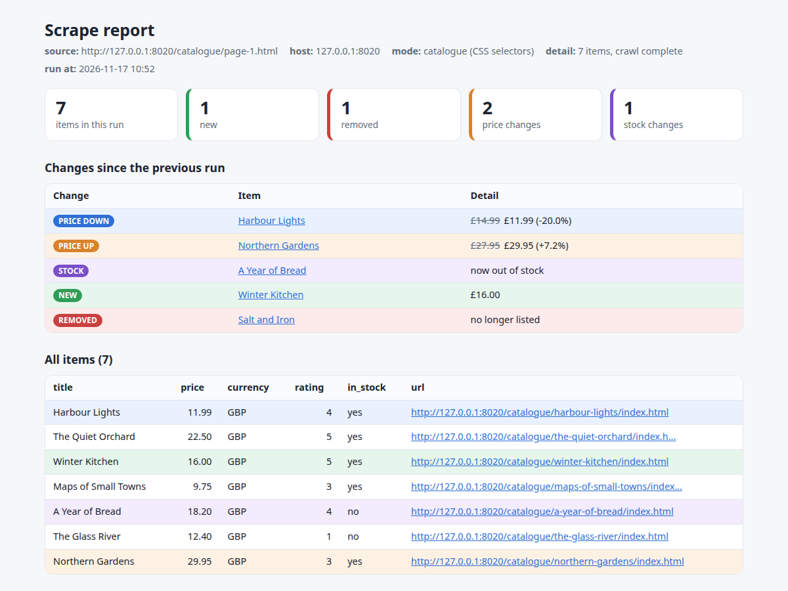
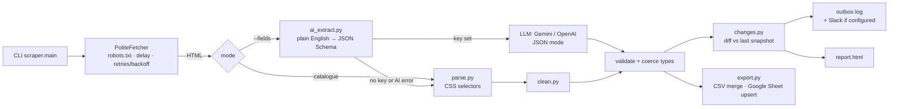

# Website Scraper → Clean Google Sheet, with Change Alerts

 

**A polite, scheduled scraper that turns a product catalogue (or any page you describe in plain English) into a clean, typed spreadsheet - and tells you what changed since yesterday: new items, removed items, price drops and rises, stock changes.**



*Screenshot: the HTML report after the second run of the offline demo (`python -m scraper.demo`) against a small fictional shop served on 127.0.0.1. All shop names, titles and prices are made up for the demo.*

## Features

| | Typical quick scraper | This project |
|---|---|---|
| Choosing the data | Hand-written CSS selectors per site | Selectors **or** `--fields "name, price as number, in stock as bool"` - an LLM fills a JSON Schema built from your sentence |
| Data quality | Raw strings | Typed and validated: `£1,051.77` → `1051.77`, `Four` → `4`, `In stock (22 available)` → `TRUE` + `22`, absolute URLs; values that do not fit the schema are emptied and counted |
| Change tracking | Overwrites the file | Snapshot per run → **new / removed / price changed / stock changed**, % change per item |
| Alerts | None | Alert text appended to `outbox.log`; also to Slack when `SLACK_WEBHOOK_URL` is set |
| Report | CSV only | Self-contained HTML report with changes highlighted ([sample](docs/sample-report.html)) |
| Politeness | Hammering the site | `robots.txt` check with a clear "skipped" message, descriptive User-Agent, delay between requests, retries with exponential backoff (honours `Retry-After`, never retries 403/404) |
| Without an API key | Breaks | Everything runs offline; `--fields` falls back to the selector parser and says so in the log and report |
| Destination | Local file | De-duplicated CSV with `first_seen` / `last_seen`, plus Google Sheet upsert through an Apps Script web app (no Cloud project needed) |
| Running daily | Manual | cron line, systemd timer, Dockerfile + docker-compose, GitHub Actions CI for the tests |

## Architecture



## Quick start

Requirements: Python 3.10+, `requests`, `beautifulsoup4`, `lxml` (`pip install -r requirements.txt`).

**1. Offline demo (no key, no internet):**

```bash
python -m scraper.demo
```

Serves `demo_site/day1` on `http://127.0.0.1:8020`, scrapes it, switches to `demo_site/day2` (one price drop, one price rise, one item out of stock, one new, one removed), scrapes again, then tries a page that `robots.txt` disallows. Open `output/demo/report.html`; the alert is in `output/demo/outbox.log` ([sample](docs/sample-outbox.log)).

You can also serve the demo shop yourself and point the CLI at it:

```bash
python -m http.server 8020 --bind 127.0.0.1 --directory demo_site/day1
python -m scraper.main --url http://127.0.0.1:8020/catalogue/page-1.html --pages 0 --delay 0.3
```

**2. Real catalogue run** (books.toscrape.com, a public sandbox built for scraping practice):

```bash
python -m scraper.main --pages 2            # 40 books -> output/books.csv + report.html
python -m scraper.main --pages 2 --details  # also UPC, category, exact stock count
```

**3. Describe the fields in plain English:**

```bash
python -m scraper.main --url https://books.toscrape.com/catalogue/page-1.html \
  --fields "title, price as number, in stock as bool, rating (integer), link as url"
python -m scraper.main --fields "title, price as number" --show-schema   # print the JSON Schema
```

Writes `output/extracted.csv` and `output/extracted.json` (with the schema and the mode used). With `GEMINI_API_KEY` or `OPENAI_API_KEY` in the environment, the LLM reads the page and fills the schema. Without a key - or if the API call fails or returns invalid JSON - it falls back to the selector parser, maps the field names it knows (`title/name`, `price`, `in_stock/available`, `rating`, `url/link`, `image`) and warns about fields it cannot fill.

Types understood in the sentence: `as number` / `as integer` / `as bool` / `as url` / `as text`, also written as `price (number)` or `price: number`. Without a type, the name is used as a hint (`price` → number, `link` → url, `in_stock` → boolean, `rating` → integer).

**Tests (offline):**

```bash
python -m unittest discover tests -v
```

**Docker:**

```bash
docker compose run --rm scraper                                    # offline demo
docker compose run --rm scraper python -m scraper.main --pages 2   # real run, files in ./output
```

## Options

| Flag | Default | Meaning |
|---|---|---|
| `--url` / `--start-url URL` | books.toscrape.com page 1 | page to start from |
| `--fields "..."` | off | plain-English field list (single page) |
| `--no-ai` | off | with `--fields`: force the selector mode |
| `--show-schema` | off | with `--fields`: print the JSON Schema and exit |
| `--pages N` | 2 | listing pages to follow, `0` = all |
| `--details` | off | also fetch each product page |
| `--delay S` | 1.5 | seconds between requests |
| `--retries N` | 3 | attempts per page on timeouts, 429 and 5xx (backoff 2 s, 4 s, ...) |
| `--out PATH` | `output/books.csv` (`output/extracted.csv` with `--fields`) | CSV to write / merge into |
| `--report PATH` | `<out dir>/report.html` | HTML report |
| `--outbox PATH` | `<out dir>/outbox.log` | where alerts are appended |
| `--push` | off | upsert rows into the Google Sheet |

Exit codes: `0` ok, `1` start page not found, `2` configuration problem, `3` skipped because of `robots.txt`.

## Configuration (environment or `.env`)

| Variable | Purpose |
|---|---|
| `GEMINI_API_KEY` / `GEMINI_MODEL` | AI extraction with Gemini (default `gemini-3.5-flash`) |
| `OPENAI_API_KEY` / `OPENAI_MODEL` | AI extraction with OpenAI (default `gpt-4o-mini`), used if no Gemini key |
| `SLACK_WEBHOOK_URL` | also post change alerts to Slack (off when empty) |
| `SHEETS_WEBAPP_URL`, `SHEETS_SHARED_SECRET` | `--push` target (see below) |

Keys are read from the environment only and never logged; error messages contain only HTTP status codes.

## How change detection works

After each run a small snapshot (`<out>.snapshot.json`: key → title, price, currency, stock, URL) is saved. The next run is compared with it. Items are matched on the product URL (in `--fields` mode: the first URL field, otherwise the first field). "Removed" is only reported when the crawl reached the last page, so a `--pages 2` run does not flag everything else as removed. The first run is the baseline and sends no alert.

## Pushing to Google Sheets

1. Create a Google Sheet, open *Extensions → Apps Script*, paste `apps_script/Code.gs`.
2. *Project Settings → Script properties*: add `SHARED_SECRET`.
3. *Deploy → New deployment → Web app* (Execute as: Me, Who has access: Anyone).
4. `cp .env.example .env` and set `SHEETS_WEBAPP_URL` and `SHEETS_SHARED_SECRET`.
5. `python -m scraper.main --pages 0 --details --push`

The script writes to a tab named `Products`, matched on the key column, and stamps "Last updated" next to the header. `--fields` runs push their own columns.

## Running it daily

**cron** (`crontab -e`, see `deploy/crontab.example`):

```cron
30 6 * * * cd /path/to/scraper-to-sheet && mkdir -p logs && /usr/bin/python3 -m scraper.main --pages 0 --details --push >> logs/scraper.log 2>&1
```

**systemd user timer** (`deploy/scraper.service` + `deploy/scraper.timer`):

```bash
mkdir -p ~/.config/systemd/user
cp deploy/scraper.service deploy/scraper.timer ~/.config/systemd/user/
# edit WorkingDirectory in scraper.service to the project path
systemctl --user daemon-reload
systemctl --user enable --now scraper.timer
```

## What is tested, and what needs your own accounts

- **Tested offline** (`tests/`, 34 tests): cleaning and parsing, merge, retries/backoff with a fake session (no real waiting), rate-limit wait, `robots.txt` rules, plain-English field parsing, JSON Schema, type coercion, LLM JSON parsing, AI mode with a mocked LLM, fallback on API error and on invalid JSON, change detection, outbox and Slack calls (mocked), report highlighting and HTML escaping, and an end-to-end run of the demo over real HTTP on 127.0.0.1.
- **Needs a key to try**: AI extraction against a real LLM. The request format follows the public Gemini / OpenAI REST APIs, but this repository's tests mock the model.
- **Needs a Slack webhook / Google Sheet**: real Slack posting and `--push` are not exercised by the tests.
- `--fields` reads one page; pagination is handled in catalogue mode. Pages that render their content with JavaScript need a headless browser or the site's JSON endpoint in front of this pipeline.

## Responsible scraping

The live examples target books.toscrape.com, which exists for scraping practice; the demo shop is local and fictional. For real sites: read the terms of service, respect `robots.txt` and rate limits, prefer an official API when one exists, and do not collect personal data without a lawful basis. Page text sent to an LLM is treated as data; the prompt tells the model to ignore instructions found in the page, and the output is validated against the schema.

## File tree

```
scraper-to-sheet/
├── scraper/
│   ├── main.py        # CLI: fetch -> extract -> clean -> diff/alert/report -> CSV -> optional push
│   ├── fetch.py       # polite fetcher: User-Agent, robots.txt, delay, retries with backoff
│   ├── parse.py       # BeautifulSoup + lxml selectors for listing and product pages
│   ├── ai_extract.py  # plain-English fields -> JSON Schema -> LLM or selector fallback, validation
│   ├── llm.py         # Gemini / OpenAI JSON-mode client (requests, keys from env)
│   ├── clean.py       # price / rating / availability normalisation
│   ├── changes.py     # snapshot, diff, alert to outbox / Slack
│   ├── report.py      # HTML run report
│   ├── export.py      # dedupe, daily merge, CSV writer, Google Sheet upsert
│   └── demo.py        # one-command offline demo (local fictional shop, day 1 -> day 2)
├── demo_site/         # day1/ and day2/ of the fictional shop (scripts/make_demo_site.py)
├── apps_script/Code.gs
├── deploy/            # crontab.example, scraper.service, scraper.timer
├── docs/              # report.png, sample-report.html, sample-outbox.log, sample-output.png
├── output/sample-books.csv   # real run on books.toscrape.com: 2 pages with --details (40 rows)
├── tests/             # offline tests + HTML fixture
├── Dockerfile, docker-compose.yml, .github/workflows/tests.yml
├── .env.example
└── requirements.txt
```
